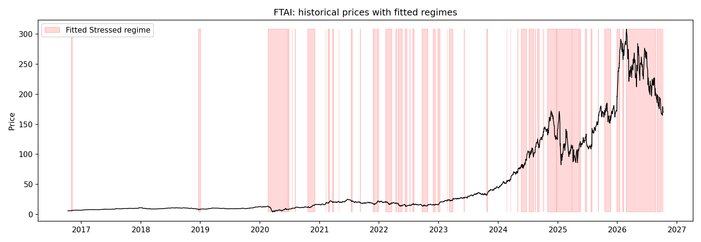
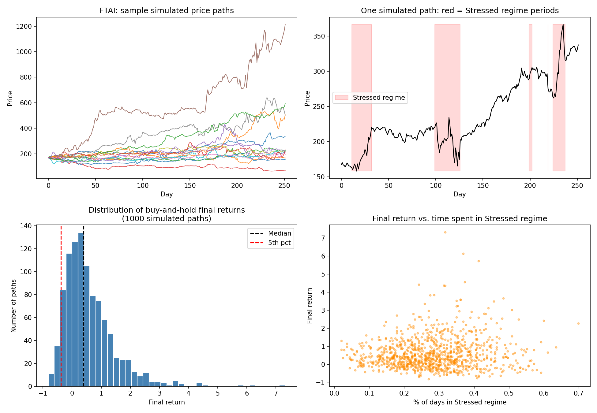
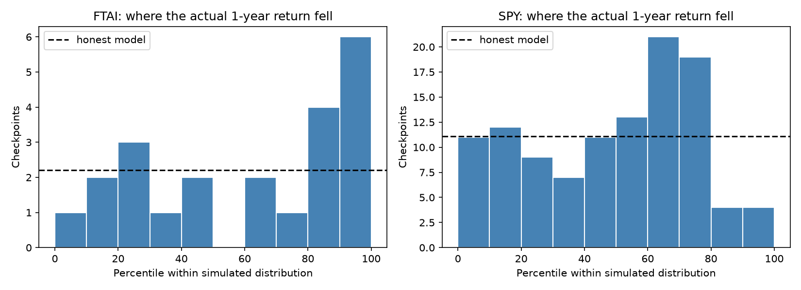

# Final Return Predictor

A Monte Carlo simulator for a stock's one-year buy-and-hold return that models markets as switching between a **calm** and a **stressed** volatility regime. The regimes are fitted to the stock's own price history with a two-state hidden Markov model, implemented from scratch in NumPy (Baum-Welch / EM).

```bash
pip install -r requirements.txt
python regime_model.py FTAI          # fit, simulate 1,000 one-year paths, save charts
python test_fitter.py                # check the fitter recovers known parameters (offline)
python calibration_check.py FTAI SPY # out-of-sample check of the simulated ranges
```

## How it works

1. **Download** 10 years of daily adjusted prices with `yfinance`.
2. **Fit the regimes.** Each day's return is assumed to come from a normal distribution whose mean and volatility depend on a hidden regime that follows a Markov chain. The EM algorithm alternates between estimating how likely each day was to be calm or stressed (forward-backward pass, scaled to avoid underflow) and re-estimating the means, volatilities and transition matrix, until the log-likelihood stops improving.
3. **Simulate.** Starting from today's real price and the regime the model assigns to today, it generates 1,000 one-year (252-day) paths, switching regimes day by day with the fitted transition probabilities.
4. **Summarize** the distribution of buy-and-hold returns: mean, median, spread, 5th and 95th percentiles, and the share of paths that lose money.

## Example: FTAI Aviation (October 2026)

Fitted on 2,513 trading days:

| Regime | Mean / day | Volatility / day | Average spell |
|---|---|---|---|
| Calm | +0.14% | 1.60% | 30 days |
| Stressed | +0.29% | 5.48% | 12 days |

The model puts FTAI in the stressed regime 29% of the time in the long run.



Simulated one-year buy-and-hold outcomes from $169.96:

| Statistic | Value |
|---|---|
| Median return | +39.3% |
| Mean return | +58.8% |
| 5th percentile | −38.5% |
| 95th percentile | +218.9% |
| Paths that lose money | 25.0% |



**What this shows, and what it doesn't.** The volatility and regime structure are well estimated: FTAI's stressed days are more than three times as volatile as its calm ones. The average returns are not. FTAI rose sharply over the fitting window, so the model expects it to keep doing that, and the stressed regime even has the *higher* mean, because the stock's biggest up days happened in volatile stretches. That is why time spent stressed is slightly *positively* correlated with the final return here (0.10). Ten years of daily data can pin down volatility, but not drift, so treat the downside range as the useful output and the mean as an optimistic guess.

## Validation

**Does the fitter work?** `test_fitter.py` generates 10 synthetic ten-year histories from known parameters close to FTAI's, fits each one, and compares:

| Parameter | True | Fitted (average of 10) |
|---|---|---|
| Calm volatility | 1.60% | 1.61% |
| Stressed volatility | 5.50% | 5.48% |
| P(calm → stressed) | 0.033 | 0.029 |
| P(stressed → calm) | 0.080 | 0.073 |
| Calm mean | 0.14% | 0.16% |
| Stressed mean | 0.29% | 0.41% |

It assigns 95.3% of days to the correct regime. Volatilities and transitions come back accurately; the means are noticeably off even when the model is exactly right, which matches the drift problem above.

**Are the simulated ranges honest?** `calibration_check.py` walks forward through a stock's history one quarter at a time. At each checkpoint it fits the model on the previous five years only, simulates the next year, and records where the actual one-year return landed in the simulated distribution. An honest model sees the actual return fall below its 5th percentile about 5% of the time and above its 95th about 5% of the time. Running it with `--synthetic` on data generated by the model itself gives 5.3% and 5.3%, which confirms the check is wired correctly.

Results on FTAI (22 quarterly checkpoints):

| | FTAI | Honest model |
|---|---|---|
| Actual return below the simulated 5th percentile | 0.0% | ~5% |
| Actual return above the simulated 95th percentile | 13.6% | ~5% |
| Inside the 90% range | 86.4% | ~90% |
| Average percentile of the actual return | 62.5% | ~50% |

The actual one-year return landed inside the model's 90% range 19 times out of 22. It never fell below the range, and it beat the top of it 3 times. **The model was too pessimistic for FTAI:** the stock kept outperforming even the drift the model learned from the previous five years. With only 22 overlapping windows this is weak evidence, but it points the same way as the drift problem: the model's ranges are reasonable, and its sense of where the center is depends on how the stock happened to perform in the fitting window.

On SPY there is far more history (111 quarterly checkpoints), and the picture is better. Splitting the simulated distribution into tenths, an honest model would see about 11 actual returns land in each tenth:

| Tenth of simulated range | 0–10 | 10–20 | 20–30 | 30–40 | 40–50 | 50–60 | 60–70 | 70–80 | 80–90 | 90–100 |
|---|---|---|---|---|---|---|---|---|---|---|
| SPY checkpoints | 11 | 12 | 9 | 7 | 11 | 13 | 21 | 19 | 4 | 4 |

The bottom of the range is about right: SPY's real return fell in the model's worst tenth 11 times, exactly as often as it should. The top is too wide: only 8 returns reached the top fifth against 22 expected, while the 60th–80th percentile band is overcrowded. For the index, the model gets the downside right and overstates how big a great year can be.



## Limitations

- **Drift is unreliable** (see above). A common fix is to keep the fitted volatilities and transitions but set both regime means to the long-run average.
- **Normal returns within each regime.** Real daily returns have fatter tails than a normal distribution even within a regime.
- **Two regimes, fixed over time.** The parameters are fitted once on the whole window and don't change.
- **Buy-and-hold only.** The next step is testing strategies that de-risk when the model believes the stock has entered the stressed regime.
